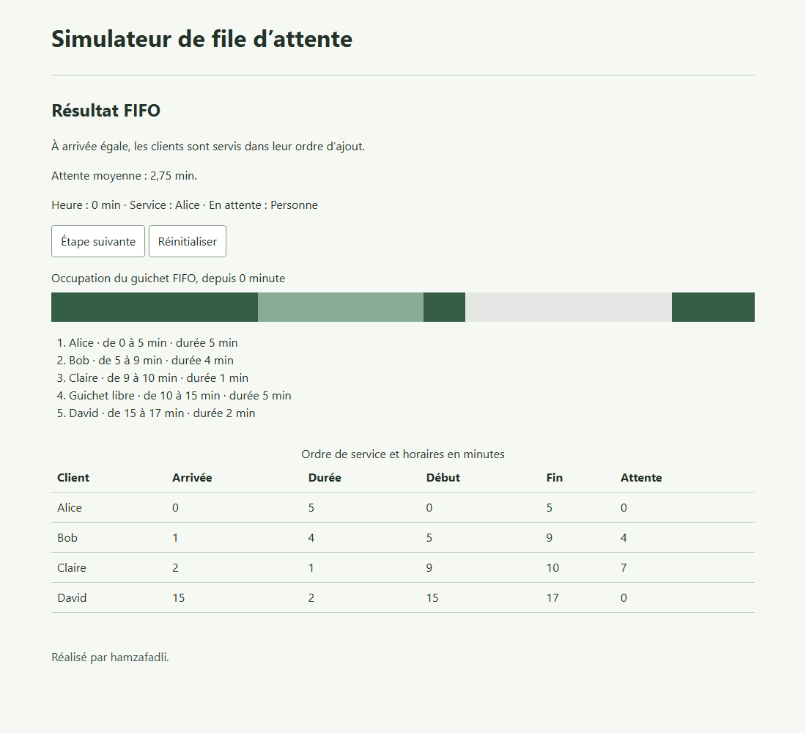
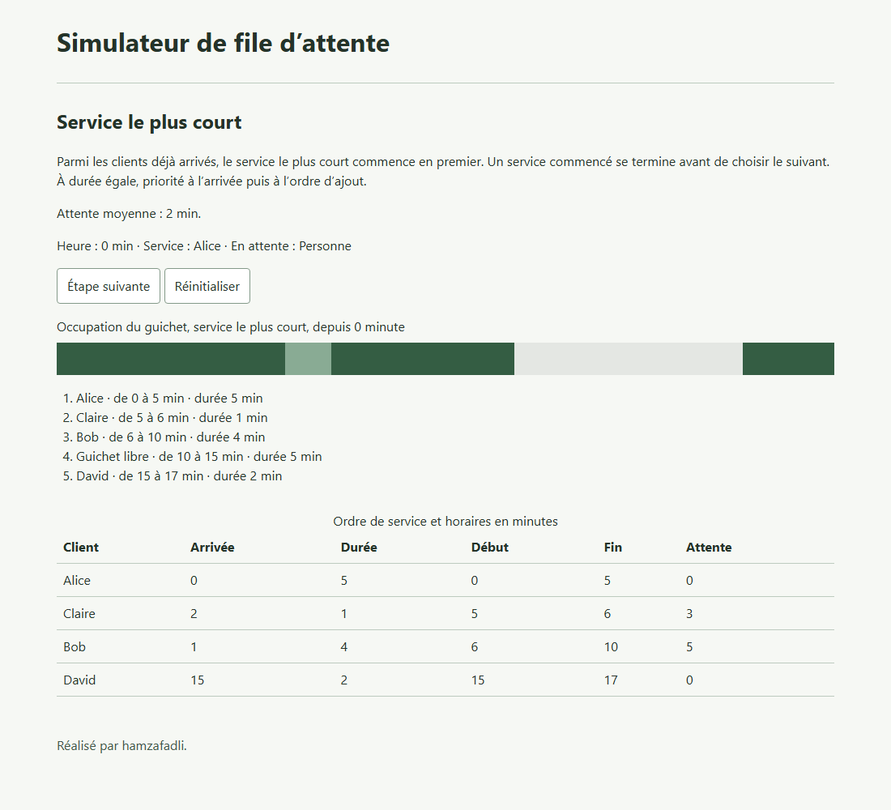

# Simulateur de file d’attente

Projet réalisé par **hamzafadli**.

Une page web pour comparer FIFO et le service le plus court sur un guichet unique. Chaque client possède un nom, une heure d’arrivée et une durée de service en minutes entières.

## Lancer

Téléchargez ou clonez ce dépôt, puis ouvrez `index.html` dans un navigateur. Le projet fonctionne hors ligne avec HTML, CSS et JavaScript, sans installation.

1. Ajoutez vos clients avec une arrivée supérieure ou égale à zéro et une durée strictement positive.
2. Cliquez sur **Simuler FIFO** ou **Comparer les deux algorithmes**.
3. Consultez les horaires, les attentes, les moyennes et les frises.
4. Utilisez **Étape suivante** pour avancer au prochain événement et **Réinitialiser** pour revenir à l’heure zéro.

Les clients restent dans leur ordre d’ajout. Ajouter ou supprimer un client efface les résultats précédents. Les données sont conservées pendant l’ouverture de la page.

## Algorithmes

- **FIFO** sert les clients par arrivée, puis par ordre d’ajout.
- **Service le plus court** choisit la durée minimale parmi les clients déjà arrivés. À durée égale, priorité à l’arrivée puis à l’ordre d’ajout. Un service commencé va jusqu’à sa fin.

Le début est le maximum entre la disponibilité du guichet et l’arrivée du client. La fin est le début plus la durée. L’attente est le début moins l’arrivée. La moyenne est calculée sur tous les clients et affichée avec au plus deux décimales.

FIFO trie une copie de la liste en O(n log n). Le service le plus court parcourt les clients disponibles à chaque sélection, en O(n²). Les calculs conservent les données saisies et refusent un horaire dépassant la précision entière de JavaScript.

## Exemple

| Client | Arrivée | Durée |
| --- | ---: | ---: |
| Alice | 0 | 5 |
| Bob | 1 | 4 |
| Claire | 2 | 1 |
| David | 15 | 2 |

FIFO sert Alice, Bob, Claire puis David. L’attente moyenne vaut **2,75 min**. Le service le plus court sert Alice, Claire, Bob puis David, avec une moyenne de **2 min**. Le guichet est libre entre 10 et 15 minutes.

Les frises représentent les durées par des largeurs proportionnelles. Les segments gris indiquent les périodes libres. La liste sous chaque frise donne les noms et horaires exacts, y compris pour les segments très courts.

## Vérifications réalisées

Liste vide, client unique, arrivées simultanées, durées égales, périodes libres, saisies invalides, suppression de clients homonymes et limites numériques. Les calculs des deux algorithmes et le parcours pas à pas ont été vérifiés. La page a aussi été testée dans Chrome avec une largeur étroite.
